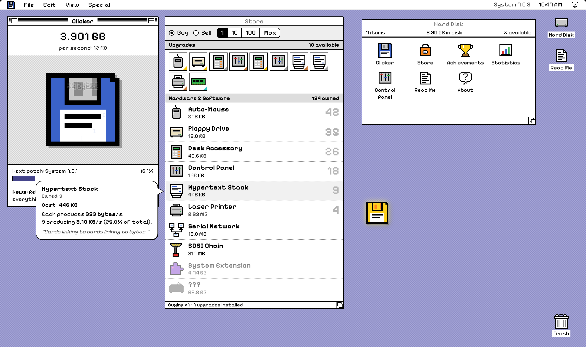

# System7 Clicker

A clicker game in the style of a classic early-'90s desktop (think System 7). Click the floppy disk to write bytes, then spend them on hardware and software that write more bytes for you. It plays like Cookie Clicker, and the whole thing is a beige computer.



It's plain HTML, CSS and JavaScript with no build step and no backend, so any static web server can host it. The instructions below use Caddy on Alpine Linux.

## Features

- **Clicking and idling:** 16 buildings, from the *Auto-Mouse* and *Floppy Drive* up through *SCSI Chains*, *Dial-up Modems* and *CD-ROM Towers* to the *Quantum Desktop*. Prices go up 15% with each one you buy, like in Cookie Clicker.
- **136 upgrades:** 7 tiers per building, system-wide production boosts, clicking upgrades, luck upgrades and trash upgrades.
- **Lucky Disks:** golden floppies show up on the desktop now and then. Click one for a big bonus, a 7× *Frenzy*, a 777× *Click Frenzy*, or a *Defrag Rush*.
- **System errors:** a bomb dialog appears every so often. *Resume* is the safe choice. *Restart* is a gamble.
- **Trash:** junk files pile up in the Trash over time. Empty it to recycle them into bytes.
- **System Updates (prestige):** start over to earn permanent *patches*, each worth +1% production. The menu bar shows your version going from System 7.0 to 7.0.1, 7.1 and up.
- **146 achievements** (each one adds +1% production), including secret ones hidden around the desktop.
- **Offline progress:** your computer keeps writing at half speed while you're away (up to 7 days).
- **Saving:** autosaves to `localStorage` every 30 seconds and when you leave the page. **File ▸ Export Save…** lets you copy a code or download a `.txt` file, and **File ▸ Import Save…** takes a pasted code or a file.
- **The desktop:** draggable windows with striped title bars, close, zoom and roll-up boxes, and resize handles. There's a menu bar with menus that blink when you pick an item, desktop icons, a Finder-style Hard Disk window, Balloon Help, a Control Panel with 10 desktop patterns, synthesized sound effects and a startup screen with an icon parade. All the pixel art is original.
- **Phones:** on narrow screens the windows stack vertically.

## Self-hosting on Alpine Linux with Caddy

### Option A: install script

On the Alpine machine, as root:

```sh
apk add git
git clone https://github.com/wypiek/system7-clicker.git
cd system7-clicker

# With a domain that points at this machine (Caddy gets HTTPS certificates automatically):
sh deploy/install-alpine.sh clicker.example.com

# Or plain HTTP on your local network:
sh deploy/install-alpine.sh :80
```

The script:

1. installs `caddy` with `apk` (the `community` repository must be enabled in `/etc/apk/repositories`),
2. copies the game to `/var/www/system7-clicker` (set `WEBROOT=...` to use another folder),
3. writes `/etc/caddy/Caddyfile` from [`deploy/Caddyfile`](deploy/Caddyfile) and backs up any existing one first (set `SKIP_CADDYFILE=1` to keep your own config),
4. enables Caddy at boot and starts or reloads it with OpenRC.

To update later, run `git pull` and then the same command again.

### Option B: by hand

```sh
apk add caddy
mkdir -p /var/www/system7-clicker
cp -R index.html css js fonts /var/www/system7-clicker/
```

Add a site block to `/etc/caddy/Caddyfile`. The full version with security and cache headers is in [`deploy/Caddyfile`](deploy/Caddyfile). The minimum is:

```caddyfile
clicker.example.com {
	root * /var/www/system7-clicker
	encode zstd gzip
	file_server
}
```

Then run:

```sh
rc-update add caddy default
rc-service caddy restart
```

### Notes

- Saves live in each player's browser (`localStorage`). They are tied to the address you serve the game from, so if you move it to a new domain, export your save first and import it on the new one.
- Over plain HTTP, the **Copy** button in the export dialog falls back to selecting the text, since browsers only allow clipboard access over HTTPS. **Download** works either way.

## Running locally

Any static server works, for example:

```sh
python3 -m http.server 8000
# or
caddy file-server --listen :8000
```

Then open <http://localhost:8000>.

## Project layout

```
index.html            page shell
css/system7.css       all styling (windows, menus, controls, balloons…)
js/pixels.js          pixel-art icons and desktop patterns (drawn at runtime)
js/data.js            buildings, upgrades, achievements, news, number formatting
js/game.js            game state, rules, events, save/load/export/import
js/ui.js              desktop, windows, menus, dialogs, sound, rendering
fonts/                Pixelify Sans (SIL Open Font License, see fonts/OFL.txt)
deploy/               Caddyfile and Alpine install script
```

## Credits

- Font: [Pixelify Sans](https://github.com/eifetx/Pixelify-Sans), SIL Open Font License 1.1.
- System7 Clicker is a fan-made tribute to early-'90s desktop computing and isn't affiliated with any computer company.
